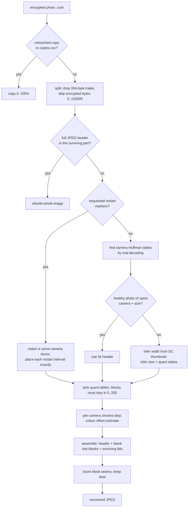

# Architecture

## Stack

| Piece | Used for | Why |
|---|---|---|
| **Python 3.11+** | everything | readable, cross-platform, easy for contributors |
| **NumPy** | statistics on decoded block values (width inference, colour, quant tables) | fast array maths |
| **Pillow** (libjpeg) | decoding rebuilt JPEGs for quality scoring, previews | fast C decoder, ubiquitous |
| **Tkinter** | desktop app | ships with Python, no extra install |
| **concurrent.futures** | worker processes | true parallelism without dependencies |
| **ctypes** (Windows) | low CPU/disk/memory priority, free-RAM check | gentle on old/failing machines |

No network access, no external services, no accounts, no GPU.

## Components (`src/photophoenix/`)

| Module | Role |
|---|---|
| `fastjpeg.py` | Table-driven baseline-JPEG Huffman decoder. Parses a header (`Donor`), decodes entropy data from any bit position, counts MCUs, records each block's DC value and whether it is flat. |
| `engine.py` | Recovery: file split, donor library, the five recovery paths, stream rebuilding, quality scoring, quant-table and chroma-step selection. |
| `colour.py` | Estimates the unknown brightness/colour offset of a scan decoded mid-stream. |
| `copies.py` | Finds and byte-verifies untouched copies of encrypted files. |
| `config.py` | Settings: defaults < `config.toml` < `.env` < `PHOTOPHOENIX_*` environment. |
| `safety.py` | Process priorities, free-RAM check, temp folder. |
| `worker.py` | Per-process worker: loads library + copy list, recovers one file, writes output. |
| `app.py` | Tkinter app: folder choice, progress, Pause/Resume/Stop, resume via `progress.json`. |
| `__main__.py` | Command line (`recover`, `build-library`, `find-copies`, default: app). |

## Data flow

The **donor library** (`local/library.json`) is built once from healthy JPEGs: one entry per
distinct (Huffman tables, chroma layout, restart interval, image size), storing only the
JPEG header segments (no image data). Workers load it in ~1 s.

## Key design decisions

- **Rebuild, don't re-encode.** Surviving entropy-coded data is spliced bit-for-bit after a
  new header; lost blocks are encoded as flat grey. No quality loss on what survived.
- **Exact facts first, estimates last.** Copies and restart markers give exact results;
  statistical estimates (width, quant tables, colour) are used only where nothing exact exists.
- **Every estimator is validated** on healthy photos with the top 150 KB hidden
  (`tools/eval_*.py`, results in `docs/validation.md`).
- **Per-camera decisions** (quant tables, chroma step) pool evidence across a camera's
  photos — single photos are too noisy.
- **Results are versioned** (`ENGINE_VERSION`); the app redoes photos recovered by an older
  engine when a method improves.
- **Never write to the source**, never search outside configured folders, never upload.

## Extending

- **New recovery path:** add a function returning `dict(jpg, frac, q, method, dims)` and call
  it from `engine.recover()` in order of exactness.
- **Other STOP/Djvu variants:** `MARKER`, `TRAILER`, `ENC_END` in `engine.py` (see
  `docs/djvu-format.md` for how they were measured).
- **Other file types** (PNG, MP4/3GP, MP3, ZIP-based Office files) are natural next steps:
  most of each file survives too. See CONTRIBUTING.md.
- **Speed:** `fastjpeg.decode` is pure Python (~2.4 MB/s per core); a Numba/Cython port of
  that one function would make recovery many times faster.
